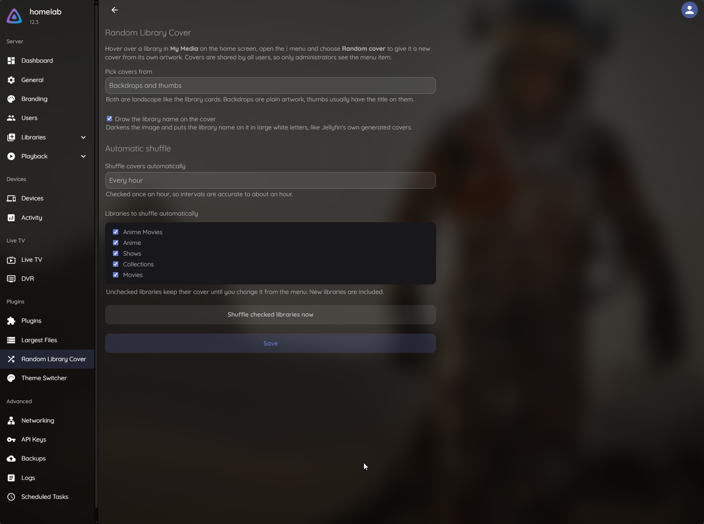

# Random Library Cover for Jellyfin

[](https://github.com/oppahansi/random-library-cover/actions/workflows/build.yml)
[](LICENSE)
[](https://discord.gg/ncKmDEArqg)

A Jellyfin plugin that adds a **Random cover** item to the ⋮ menu of the library cards in *My Media* on the home screen. One click gives the library a new cover, picked at random from the backdrops or thumbs of the movies, shows and collections in it. Covers can also be shuffled automatically on a schedule.

Without the plugin, you have to find an image, download it and upload it under *Edit images* for every library.

## Features

- **Random cover in the card menu:** hover over a library in *My Media*, open the ⋮ menu (or right-click the card) and choose **Random cover**. The card updates right away.
- **Looks like Jellyfin's own covers:** the image is darkened and the library name is drawn on it in large white letters, using Jellyfin's own cover renderer. Can be turned off for a plain image.
- **Fits the card:** only landscape images (backdrops and thumbs, roughly 16:9) are used, the same shape as the library cards. Choose backdrops only, thumbs only, or both.
- **Never the same cover twice in a row.**
- **No stale cards:** jellyfin-web caches the library list for about a minute; the card shows the new cover right away anyway, also after leaving and coming back to the home screen.
- **Automatic shuffle (optional):** every hour, 3, 6 or 12 hours, once a day, every 3 days or once a week, for the libraries you pick.
- **Shuffle now:** a button on the settings page shuffles all picked libraries at once.

Covers are shared by everyone on the server, so only administrators see the menu item and can change them.

## How covers are stored

The new cover is rendered by Jellyfin's own collage builder (the one behind the generated library covers) and saved exactly like an image uploaded under *Edit images*: as the library's primary image, `folder.jpg` in the library's folder under `<config>/root/default/`. It stays after restarts and library scans.

To go back to Jellyfin's generated collage, open *Edit images* for the library and delete the primary image.

## Settings

**Dashboard → Random Library Cover** (under *Plugins* in the sidebar):



| Setting | Default | |
|---|---|---|
| Pick covers from | Backdrops and thumbs | Backdrops are plain artwork, thumbs usually have the title on them |
| Draw the library name on the cover | On | Same look as Jellyfin's generated covers (960×540, darkened, name in the middle) |
| Shuffle covers automatically | Off | Checked once an hour, so intervals are accurate to about an hour |
| Libraries to shuffle automatically | All | New libraries are included |

## Compatibility

| Jellyfin | .NET | Release tag |
|---|---|---|
| 12.4.x | 10 | `v<version>-jellyfin-12.4` |
| 12.3.x | 10 | `v<version>-jellyfin-12.3` |
| 12.2.x | 10 | `v<version>-jellyfin-12.2` |
| 12.1.x | 10 | `v<version>-jellyfin-12.1` |
| 12.0.x | 10 | `v<version>-jellyfin-12.0` |
| 10.11.x | 9 | `v<version>-jellyfin-10.11` |
| 10.10.x | 8 | `v<version>-jellyfin-10.10` |
| 10.9.x | 8 | `v<version>-jellyfin-10.9` |

Each plugin version is released once per Jellyfin line. Pick the release that matches your server's version, shown at the top of the dashboard.

The menu item is part of the web client (browser, desktop app). Native apps such as Swiftfin, Findroid or the Android TV app don't run web client scripts, so they don't show it, but they do show the new covers. Automatic shuffling works regardless of the client.

## How the menu item gets into the web client

Jellyfin has no official way for plugins to add menu items to the web client, so the plugin adds a small script to jellyfin-web's `index.html`. On every server start it does one of two things:

1. **With the [File Transformation](https://github.com/IAmParadox27/jellyfin-plugin-file-transformation) plugin installed (recommended):** the script tag is added to `index.html` in memory as it is served. No files change on disk.
2. **Without it:** the plugin writes the script tag into `index.html` in Jellyfin's web directory. This needs write access to that directory. It isn't writable in some Docker images (for example linuxserver.io); the log then says so, and you should install File Transformation. The file is locked while it's changed, and left alone if it looks damaged, so plugins that patch it at the same time don't break it.

Uninstalling the plugin removes the tag from `index.html` again.

After installing or updating, reload the web client (Ctrl+F5 / Cmd+Shift+R) so the browser picks up the new `index.html`.

## Installation

### From the plugin repository (recommended)

Jellyfin picks the right build for your server and updates it automatically.

1. Go to **Dashboard → Plugins** and open the repository settings (**Repositories** tab or **Manage repositories**, depending on your Jellyfin version).
2. Add a repository:
   - Name: `Random Library Cover`
   - URL: `https://raw.githubusercontent.com/oppahansi/random-library-cover/main/manifest.json`
3. Open the **Catalog**, find **Random Library Cover** under *General* and install it.
4. Restart Jellyfin and reload the web client.

### Manual install

1. Download the zip for your Jellyfin version from [Releases](https://github.com/oppahansi/random-library-cover/releases).
2. Extract it into a new folder in Jellyfin's plugin directory, for example `<config>/plugins/RandomLibraryCover_1.0.0/`.
   - Docker: `/config/plugins/`
   - Linux packages: `/var/lib/jellyfin/plugins/`
   - Windows: `%ProgramData%\Jellyfin\Server\plugins\`
3. Restart Jellyfin and reload the web client.

## API

```
POST /RandomLibraryCover/Libraries/{libraryId}/Shuffle
```

Gives one library a new random cover. Returns `200` with `{ "Success": true, "SourceItemId": "…", "SourceName": "…" }`, `404` if the id isn't a library, or `422` with an `Error` message if the library has no usable images. Needs an administrator session or API key.

```
POST /RandomLibraryCover/Libraries/Shuffle
```

Shuffles every library picked for automatic shuffling. Returns `{ "Shuffled": <count> }`. Needs an administrator session or API key.

```
GET /RandomLibraryCover/ClientScript
```

The web client script. No authentication, because it loads before login.

## Building

Requirements: the [.NET 10 SDK](https://dotnet.microsoft.com/download). It can also build the .NET 8 and .NET 9 targets used by older Jellyfin versions.

Build against the newest supported Jellyfin version:

```sh
dotnet build Jellyfin.Plugin.RandomLibraryCover -c Release
```

### Building for a different Jellyfin version

Pass the Jellyfin version you want to build against. The matching .NET target framework is chosen automatically:

```sh
dotnet build Jellyfin.Plugin.RandomLibraryCover -c Release -p:JellyfinVersion=10.10.7
```

| `JellyfinVersion` | Target framework |
|---|---|
| 10.9.x, 10.10.x | `net8.0` |
| 10.11.x | `net9.0` |
| 12.x | `net10.0` |

### Packaging

`scripts/package.sh` builds and packages one Jellyfin version as an installable zip (the DLL plus `meta.json`):

```sh
scripts/package.sh 12.3.0 1.0.0
# -> dist/randomlibrarycover_1.0.0_jellyfin-12.3.zip
```

Package every supported version:

```sh
for v in $(jq -r '.[]' targets.json); do scripts/package.sh "$v" 1.0.0; done
```

### Versioning

Plugin versions use [semantic versioning](https://semver.org). Jellyfin needs every build in the repository manifest to have its own version, so the fourth component encodes the Jellyfin line. For example, `1.0.0.1011` is plugin `1.0.0` built for Jellyfin `10.11`, and `1.0.0.1203` is the build for `12.3`.

## Releasing

1. Add a section for the new version to [CHANGELOG.md](CHANGELOG.md) and push it to `main`.
2. Run the **Release** workflow under *Actions* and enter the version (for example `1.1.0`).

The workflow builds every version in [`targets.json`](targets.json), publishes one GitHub release per Jellyfin line and commits the updated `manifest.json`.

To support a new Jellyfin version, add it to `targets.json`. If it uses a newer .NET version, also extend the `TargetFramework` conditions in the `.csproj`.

## Contributing

Bug reports, ideas and pull requests are welcome. See [CONTRIBUTING.md](CONTRIBUTING.md).

## License

[MIT](LICENSE) © oppahansi

This project is not affiliated with the Jellyfin project.
